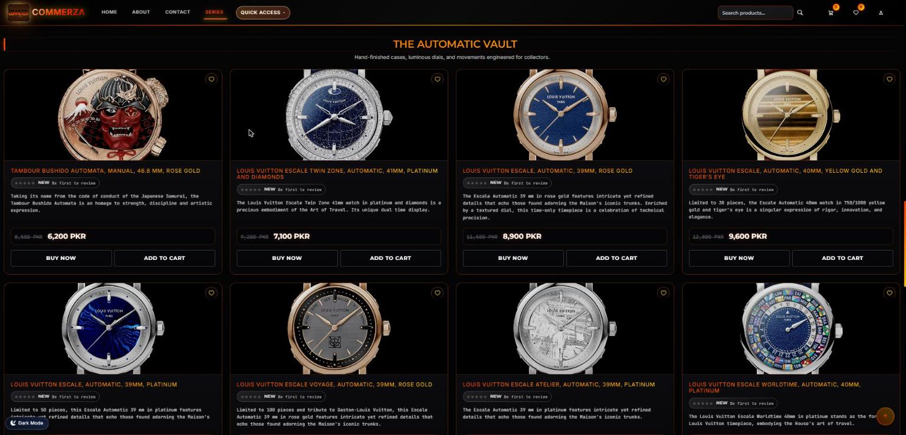
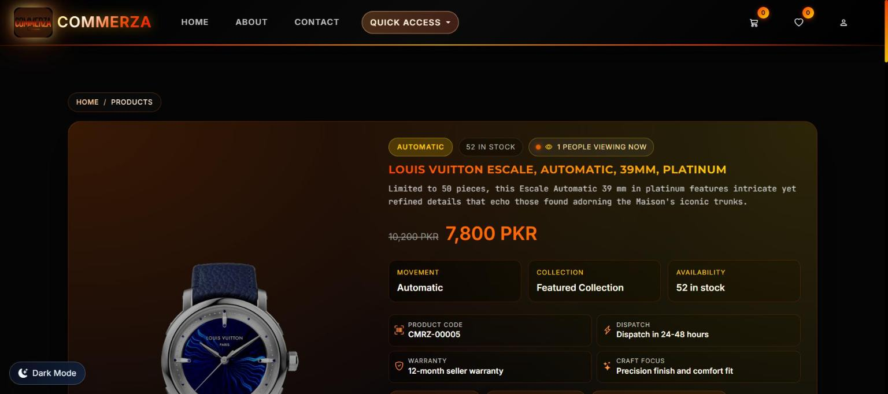
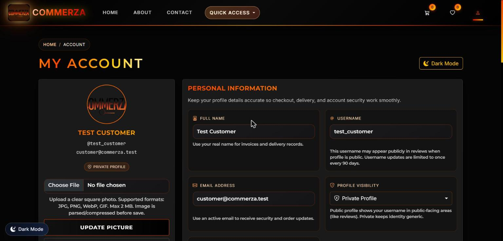
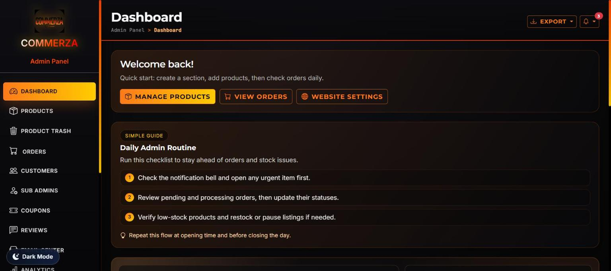
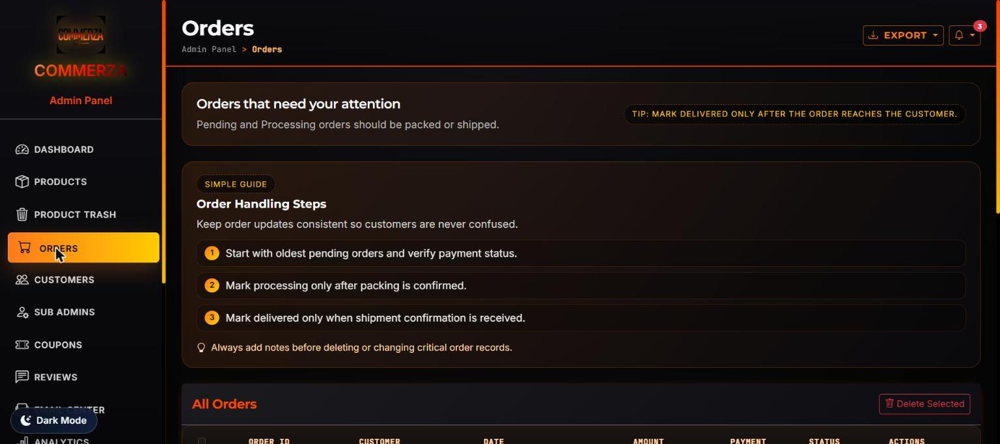
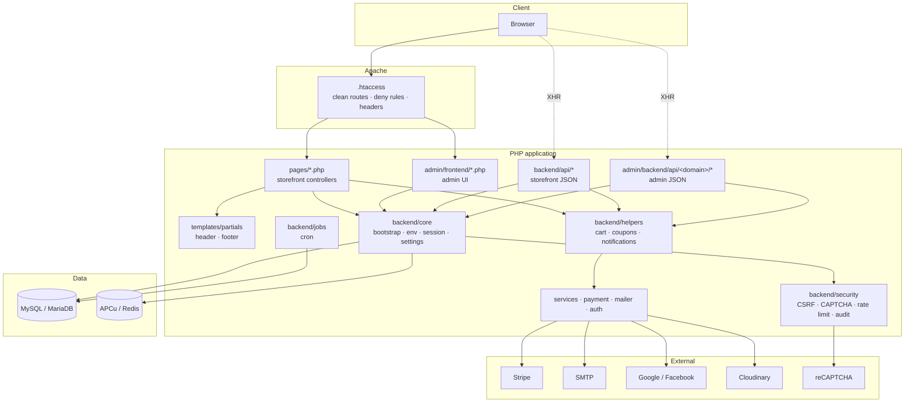
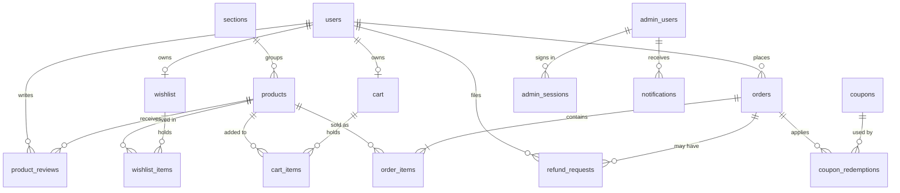
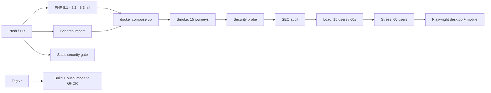

<p align="center">
  
</p>

<h1 align="center">Commerza</h1>

<p align="center">
  <strong>A security-first PHP + MySQL ecommerce platform with a luxury-watch storefront and a role-based admin panel. No framework.</strong>
</p>

<p align="center">
  <a href="https://github.com/ahmershahdev/commerza/releases/latest"></a>
  <a href="https://github.com/ahmershahdev/commerza/actions/workflows/ci.yml"></a>
  <a href="https://github.com/ahmershahdev/commerza/actions/workflows/security-gate.yml"></a>
  
  
  
  <a href="LICENSE"></a>
</p>

<p align="center">
  <a href="#quick-start">Quick start</a> ·
  <a href="#features">Features</a> ·
  <a href="#architecture">Architecture</a> ·
  <a href="#database">Database</a> ·
  <a href="docs/ARCHITECTURE.md">Docs</a> ·
  <a href="instructions.md">Integrations</a> ·
  <a href="https://ahmershah.dev/projects/commerza">Case study</a>
</p>

---

<p align="center">
  
</p>

## Screenshots

| Catalog | Product detail |
| --- | --- |
|  |  |
| **Light theme** | **Customer account** |
|  |  |
| **Admin dashboard** | **Admin order management** |
|  |  |

## Features

### Storefront

- Catalog with sections, series pages, filtering by section/movement/price, live search suggestions
- Product pages with clean slugs (`/products/<slug>`), live viewer count, verified-purchase reviews with images
- Cart, wishlist, and compare with server-side stock and blacklist checks
- Checkout with **Cash on Delivery** and **Stripe** card payments, coupons, free-shipping threshold, and email OTP for high-value COD orders
- Accounts: signup with email verification, Google/Facebook OAuth, remember-me sessions, profile and avatar, order history, refunds, account deletion
- Order tracking and printable invoices
- Dark (orange/black) and light (navy/white) themes

### Admin panel

- KPI dashboard and analytics (orders, customers, live viewers)
- Products, sections, trash and restore, bulk import/export
- Orders with status workflow, delivery ETA, refund moderation, shipping rules
- Coupons, reviews moderation, customer directory and blacklist
- Website content: slider, ticker, testimonials, social links, SEO meta
- Email center with templates and recipients
- Sub-admins with role presets, custom permissions, hidden tabs, suspension, and instant session revocation
- Email 2FA on every admin login and a security event log

### Security

- Prepared statements everywhere request data reaches SQL
- CSRF tokens, layered CAPTCHA (reCAPTCHA v3, then v2, then a built-in fallback challenge), and honeypots
- Per-scope rate limiting with progressive blocking
- Argon2id password hashing (bcrypt fallback) with a strict policy
- Per-request CSP nonce, HSTS, COOP/CORP, and hardened session cookies
- Idempotency keys plus transactions and `SELECT ... FOR UPDATE` on checkout and refunds
- Upload validation with re-encoding and optional ClamAV scanning
- CI security gate, smoke tests, XSS crawler, and admin abuse tests

## Tech stack

| Layer | Technology |
| --- | --- |
| Language | PHP 8.1+ (strict types in critical paths), mysqli prepared statements, PDO helper |
| Database | MySQL 8 / MariaDB 10.4+, InnoDB, utf8mb4, 43 tables + 11 views |
| Web server | Apache 2.4 with `mod_rewrite`, `mod_headers`, `mod_expires`, `mod_deflate` |
| Frontend | Server-rendered PHP templates, Bootstrap 5.3, Bootstrap Icons, jQuery 3.7, Chart.js |
| Payments | Stripe PaymentIntents (Stripe.js v3), Cash on Delivery |
| Media | Local assets or Cloudinary (optional) |
| Email | SMTP with primary/secondary failover, `log` driver for development |
| Auth | Sessions + remember-me tokens, Google & Facebook OAuth, admin email 2FA |
| Caching | Runtime → APCu → Redis layers, OPcache preload |
| CI | GitHub Actions: PHP 8.1–8.3 lint, schema import test, security gate |

## Quick start

### Requirements

- PHP 8.1+ with `mysqli`, `openssl`, `mbstring`, `gd`, `curl`, `fileinfo`
- MySQL 8 or MariaDB 10.4+
- Apache with `mod_rewrite` and `AllowOverride All` ([XAMPP](https://www.apachefriends.org/) works out of the box)

### 1. Get the code

```bash
cd C:/xampp/htdocs          # or your Apache document root
git clone https://github.com/ahmershahdev/commerza.git
cd commerza
```

### 2. Create the database

```bash
mysql -u root -e "CREATE DATABASE commerza CHARACTER SET utf8mb4 COLLATE utf8mb4_unicode_ci"
mysql -u root commerza < database/commerza.sql
```

### 3. Configure the environment

```bash
cp .env.example .env
```

For local development, set at least:

```dotenv
COMMERZA_APP_URL=http://localhost/commerza
COMMERZA_DB_HOST=localhost
COMMERZA_DB_USER=root
COMMERZA_DB_PASS=
COMMERZA_DB_NAME=commerza

COMMERZA_MAIL_DRIVER=log            # emails (OTP, 2FA, receipts) are written to storage/mail/
COMMERZA_CAPTCHA_BYPASS_LOCAL=1     # skip CAPTCHA on localhost

COMMERZA_ADMIN_BOOTSTRAP_EMAIL=admin@example.com
COMMERZA_ADMIN_BOOTSTRAP_PASSWORD=Change-Me-2026!
COMMERZA_ADMIN_RESET_KEY=<a long random string>
```

### 4. Run it

Start Apache and MySQL, then open:

- Storefront: <http://localhost/commerza/>
- Admin: <http://localhost/commerza/admin-login>

The first admin account is created automatically from `COMMERZA_ADMIN_BOOTSTRAP_*`. Admin login always asks for an email code. With `COMMERZA_MAIL_DRIVER=log`, open the newest file in `storage/mail/` to read it.

To set or reset an admin password from the command line:

```bash
php scripts/dev/reset_admin_password.php admin@example.com 'New-Strong-Pass-2026!'
```

Full provider setup (OAuth, Stripe, SMTP, reCAPTCHA, Cloudinary, cron) is in [instructions.md](instructions.md).

## Architecture



### Project structure

```text
commerza/
├── pages/                  Storefront pages, one per route (/cart → pages/cart.php)
├── templates/partials/     Shared site header and footer
├── admin/
│   ├── frontend/           Admin login, 2FA, recovery, panel (+ CSS/JS)
│   └── backend/            auth/ and api/<domain>/ JSON endpoints
├── backend/
│   ├── core/               Bootstrap, env, routing, site settings, view helpers
│   ├── api/                Storefront JSON APIs
│   ├── auth/               OAuth
│   ├── security/           CSRF, CAPTCHA, passwords, rate limits, audit log
│   ├── helpers/            Cart, coupons, notifications, media, wishlist
│   ├── services/ payment/ mailer/ cache/ jobs/
├── frontend/assets/        CSS (themes, modules, pages), JS (modules, pages), images, vendor
├── database/commerza.sql   Schema + catalog seed
├── scripts/                dev/, maintenance/, security/
├── docs/                   Architecture, database, screenshots
└── .github/                CI, security gate, templates, Dependabot
```

How a request flows, the layer responsibilities, and how to add a page or API are covered in [docs/ARCHITECTURE.md](docs/ARCHITECTURE.md).

## Database



The full ERD with columns, table groups, and reporting views is in [docs/DATABASE.md](docs/DATABASE.md).

## Routes

| Public | Account and checkout | Admin |
| --- | --- | --- |
| `/` `/products` `/products/<slug>` | `/login` `/signup` `/forgot-password` `/reset-password` | `/admin-login` |
| `/shop-category-a` `/shop-category-b` | `/account` `/cart` `/wishlist` `/compare` | `/admin-verify-2fa` |
| `/about` `/contact` `/faq` | `/order-tracking` `/invoice/<ORD-…>` | `/admin-panel` |
| `/shipping` `/returns` `/warranty` | `/oauth?provider=google\|facebook` | `/admin-forgot-password` `/admin-forgot-email` |
| `/privacy-policy` `/terms-of-service` | | |

Legacy `*.php` URLs redirect permanently to these clean routes.

## Testing, security and SEO reports

Every push and pull request runs the full pipeline below. All results here are from a run on 2026-10-30 against the Docker stack (`php:8.2-apache` + MariaDB 10.11).



### Run it yourself

```bash
docker compose up -d --build --wait                           # http://localhost:8080
php tests/load/load_test.php http://localhost:8080 15 60       # 15 concurrent users, 60 s
php tests/load/load_test.php http://localhost:8080 60 45       # stress
docker compose exec -T app php scripts/security/security_probe.php http://localhost
php scripts/quality/seo_audit.php http://localhost:8080
cd tests/e2e && npm install && npx playwright install chromium && npx playwright test
```

### Load and stress (15 different user journeys)

Each virtual user has its own session and runs a different journey: home browsing, two category shoppers, search suggestions, catalog API, two cart builders (real CSRF-protected `add` calls), wishlist, compare, policy readers, support/order tracking, signup/login, password reset, and reviews/live viewers.

| Scenario | Users | Requests | Throughput | Errors | p50 | p95 | p99 | Result |
| --- | --- | --- | --- | --- | --- | --- | --- | --- |
| Smoke | 15 | 34 | n/a | 0% | 119 ms | n/a | n/a | PASS |
| Load | 15 | 3,243 | 54 req/s | **0%** | 220 ms | **637 ms** | 1,033 ms | PASS |
| Stress | 60 | 2,452 | 54.5 req/s | **0%** | 891 ms | 2,893 ms | 5,828 ms | Degrades gracefully, no 5xx |

Under stress the single container reaches its throughput ceiling and latency rises, but no request fails. Rate limiting and validation answer abusive cart traffic with `403`/`422`, never `5xx`. The slowest endpoint under stress is `reviews_api.php` (p50 3.1 s), which is the next optimization target.

### Playwright end-to-end

34 tests on desktop Chrome and a Pixel 7 profile: 33 passed and 1 was skipped (the desktop-only search bar on mobile). The suite covers:

- All 12 public pages: HTTP 200, exactly one `<h1>`, title of 60 characters or fewer, footer contact details, and no console or CSP errors
- `Product` JSON-LD on product pages
- A guest adding to the cart, with the badge updating and the cart page showing the item
- Live search suggestions
- `/account` redirecting to login, with `.env`, the SQL dump, `backend/core`, and `storage/` blocked
- A legacy `/about.php` URL returning `301` to `/about`

### Security probe: 33 / 33 checks pass

| Area | What is verified | Result |
| --- | --- | --- |
| Security headers | CSP, X-Frame-Options, nosniff, Referrer-Policy, Permissions-Policy, COOP | PASS |
| CSP nonce | Fresh nonce on every request. Storefront `script-src` is nonce-only, with no `'unsafe-inline'` | PASS |
| Session cookies | `HttpOnly`, `SameSite=Lax`, `Secure` on HTTPS | PASS |
| SQL injection | Boolean, `UNION`, stacked, and time-based payloads against the products API, product route, and existence check: no SQL errors, no delays, tables intact | PASS |
| XSS | Script/SVG payloads in query strings on 4 pages are never reflected raw | PASS |
| Sensitive files | `.env`, `.git`, SQL dump, `backend/core`, `storage/`, `scripts/`, `templates/` return 403/404 | PASS |
| HTTP methods | `TRACE` disabled (`TraceEnable Off` in the image) | PASS |
| Brute force / DoS | Login is throttled after repeated failures. Every API has per-scope rate limits with progressive blocking | PASS |
| CSRF | Checkout, cart, reviews, and viewer heartbeat reject requests without a token (`security_smoke_tests.ps1`, 8/8) | PASS |
| Malicious uploads | EICAR test virus, PHP polyglot (`GIF89a<?php`), and SVG with `<script>` are rejected by the built-in signature scanner. A clean image is accepted. For real-world malware coverage, install ClamAV and set `COMMERZA_UPLOAD_SCAN_ENABLED=1` + `COMMERZA_CLAMSCAN_PATH` | PASS |
| Passwords | Argon2id (bcrypt-12 fallback) | PASS |
| Race conditions | Checkout and refunds use transactions with `SELECT … FOR UPDATE`, conditional stock decrements, and idempotency keys. Wishlist creation uses `ON DUPLICATE KEY` | Code-verified |

Volumetric DDoS can't be absorbed by any single PHP server. Put Cloudflare (or similar) in front of production. The app-level limits above cover abusive clients and brute force.

### SEO audit: 13 / 13 public pages pass

| Check | Status |
| --- | --- |
| `<title>` 60 characters or fewer, meta description 150 characters or fewer | All pages |
| Canonical URL, Open Graph (5 tags), Twitter card (4 tags) | All pages |
| Exactly one `<h1>` per page | All pages (duplicates fixed on 7 pages) |
| JSON-LD | Organization, WebSite, Store, ItemList, CollectionPage, Product + Offer, FAQPage, ContactPage, BreadcrumbList, PrivacyPolicy, TermsOfService |
| Product pages | Server-rendered title, description, OG image, and `Product` schema per product |
| Breadcrumbs | Visible breadcrumb nav on every inner page, `BreadcrumbList` schema on product and policy pages |
| Internal links | 23 to 45 internal links per page through the shared header and footer |
| `sitemap.xml` | 52 URLs (12 pages + 40 products), regenerated with `php scripts/quality/generate_sitemap.php` |
| `robots.txt`, `llms.txt`, `llms-full.txt` | Present, served, and aligned with the production domain |
| Images and assets | 41 of 49 images are WebP and every image has `alt`. CSS/JS are immutable-cached for 30 days, with gzip/brotli via `.htaccess`. Non-critical CSS loads async |

The three product videos (3–14 MB) are served through Cloudinary with `q_auto` in production. Re-encode the local copies if you serve them directly.

## Operations

| Task | Command |
| --- | --- |
| SEO audit | `php scripts/quality/seo_audit.php http://localhost/commerza` |
| Regenerate sitemap | `php scripts/quality/generate_sitemap.php https://commerza.ahmershah.dev` |
| Lint all PHP | `find . -name '*.php' -not -path './.git/*' -exec php -l {} \;` |
| Static security gate | `pwsh scripts/security/ci_security_gate.ps1` |
| Smoke tests against a running site | `pwsh scripts/security/security_smoke_tests.ps1 -BaseUrl http://localhost/commerza` |
| Backup/restore verification | `pwsh scripts/maintenance/backup_restore_test.ps1 -MySqlBinPath "C:/xampp/mysql/bin"` |
| Engagement reminders (cron) | `php backend/jobs/send_engagement_reminders.php 180` |
| Weekly / monthly reports (cron) | `php backend/jobs/weekly_analytics_report.php` · `php backend/jobs/monthly_profit_report.php` |
| Sync assets to Cloudinary | `php scripts/maintenance/cloudinary_sync.php --dry-run` |

## Production checklist

1. Serve over HTTPS. `.htaccess` redirects non-local traffic and HSTS is sent on HTTPS.
2. Keep `.env` outside version control and set `COMMERZA_MAIL_DRIVER=smtp`, `COMMERZA_CAPTCHA_BYPASS_LOCAL=0`, and `COMMERZA_OAUTH_STRICT_SSL=1`.
3. Use a strong, unique `COMMERZA_ADMIN_RESET_KEY` (16+ characters) and admin password.
4. Register production redirect URIs for Google/Facebook and the domain in reCAPTCHA.
5. Configure cron for the jobs above.
6. Align `robots.txt`, `sitemap.xml`, and `llms.txt` with the production domain.
7. Run the security gate and smoke tests after each deploy.

## Documentation

| File | Purpose |
| --- | --- |
| [docs/ARCHITECTURE.md](docs/ARCHITECTURE.md) | Layers, request lifecycle, conventions, scaling |
| [docs/DATABASE.md](docs/DATABASE.md) | ERD, table groups, import |
| [instructions.md](instructions.md) | Local setup and third-party integrations |
| [SECURITY.md](SECURITY.md) | Security policy and private disclosure |
| [CONTRIBUTING.md](CONTRIBUTING.md) | Branching, commits, pull requests |
| [CHANGELOG.md](CHANGELOG.md) | Release history |
| [llms.txt](llms.txt) / [llms-full.txt](llms-full.txt) | Guidance for AI crawlers and assistants |

## Case study and articles

| | |
| --- | --- |
| **Project case study** | [ahmershah.dev/projects/commerza](https://ahmershah.dev/projects/commerza) |
| **Building Commerza: a security-first ecommerce engine** | [Read on ahmershah.dev](https://ahmershah.dev/blogs/building-commerza-security-first-ecommerce-engine) |
| **I built a production-grade ecommerce platform in 3 months. GitHub Copilot was my co-founder** | [Read on ahmershah.dev](https://ahmershah.dev/blogs/i-built-a-production-grade-e-commerce-platform-in-3-months-github-copilot-was-my-co-founder) |
| **I almost lost Commerza** | [Read on DEV](https://dev.to/syedahmershah/i-almost-lost-commerza-the-brutal-reality-of-building-an-ecommerce-system-without-a-framework-5b78) |

## Contributing

Issues and pull requests are welcome. Read [CONTRIBUTING.md](CONTRIBUTING.md) first. Report security issues privately as described in [SECURITY.md](SECURITY.md).

## License

Released under the [MIT License](LICENSE). If Commerza helps you, a link back to this repository is appreciated.

## Author

**Syed Ahmer Shah** · [ahmershah.dev](https://ahmershah.dev) · [GitHub @ahmershahdev](https://github.com/ahmershahdev) · [Live demo](https://commerza.ahmershah.dev) · [Case study](https://ahmershah.dev/projects/commerza) · support@ahmershah.dev
