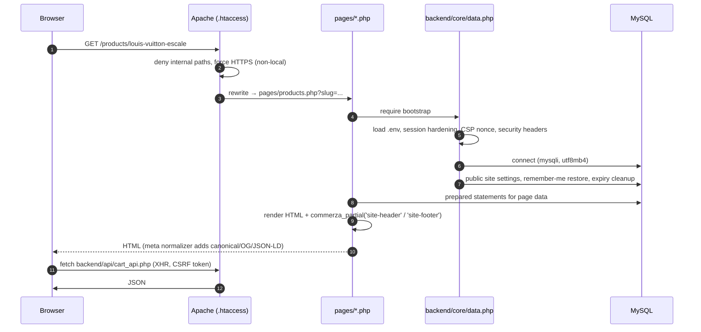
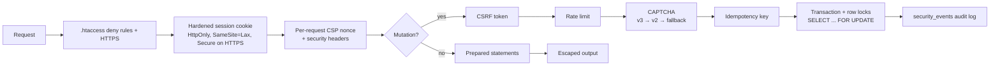

# Commerza Architecture

Commerza is a framework-free PHP 8.1+ / MySQL (MariaDB) application served by Apache. This document explains how a request moves through the code, where each kind of code lives, and the conventions to follow when you add to it.

## Directory layout

```text
commerza/
├── index.php                  # Fallback entry when mod_rewrite is unavailable (forwards to pages/index.php)
├── .htaccess                  # Clean routes → pages/*.php, deny rules for internal folders, cache + security headers
├── pages/                     # Storefront page controllers (one file per route: /cart → pages/cart.php)
├── templates/partials/        # Shared markup: site-header.php, site-footer.php
├── admin/
│   ├── frontend/              # Admin pages (login, 2FA, panel) + admin CSS/JS
│   └── backend/
│       ├── auth/auth.php      # Admin session, RBAC, 2FA, schema bootstrap
│       └── api/<domain>/      # JSON APIs: admin, analytics, catalog, commerce, content, marketing, security
├── backend/
│   ├── core/                  # Bootstrap (data.php), env loader, routing helpers, site settings, view helpers
│   ├── api/                   # Storefront JSON APIs (cart, wishlist, reviews, products, tracking, ...)
│   ├── auth/                  # Customer OAuth (Google, Facebook)
│   ├── security/              # CSRF, CAPTCHA, passwords, rate limiting, security events
│   ├── helpers/               # Domain helpers (cart, coupons, notifications, media, wishlist, tracking)
│   ├── services/              # External services (Cloudinary)
│   ├── payment/               # Stripe PaymentIntent helpers
│   ├── mailer/                # SMTP primary/secondary failover + log driver
│   ├── cache/                 # Runtime / APCu / Redis cache helpers, OPcache preload
│   └── jobs/                  # Cron jobs (reports, reminders, expiry cleanup)
├── frontend/assets/           # Storefront CSS (dark/light themes, modules, pages), JS (modules, pages), images, vendor
├── database/commerza.sql      # Schema + catalog seed (sanitized: no credentials, no runtime rows)
├── scripts/                   # dev/, maintenance/ (backups, Cloudinary), security/ (CI gate, smoke tests)
├── docs/                      # Architecture, database, screenshots
└── storage/                   # Runtime only, git-ignored (mail log driver output)
```

`database/`, `docs/`, `scripts/`, `storage/`, `templates/`, `backend/core`, and the other internal backend folders are denied by `.htaccess`, so nothing outside `pages/`, `admin/frontend/`, the JSON APIs and static assets is reachable over HTTP.

## Request lifecycle



Legacy `*.php` URLs (for example `/about.php`) are rewritten to the page, which then issues a `301` to the clean route via `commerza_maybe_redirect_clean_route()`.

## Layers and responsibilities

| Layer | Location | Responsibility |
| --- | --- | --- |
| Routing | `.htaccess`, `backend/core/bootstrap_helpers.php` | Clean URLs, legacy redirects, internal path denial |
| Bootstrap | `backend/core/data.php` | Env, session, headers, DB connection, settings payload |
| Page controllers | `pages/*.php`, `admin/frontend/*.php` | Handle form posts, query data, render views |
| Templates | `templates/partials/*.php` | Shared header/footer; isolated scope via `commerza_partial()` |
| JSON APIs | `backend/api/*.php`, `admin/backend/api/<domain>/*.php` | XHR endpoints with CSRF, rate limits, idempotency |
| Domain helpers | `backend/helpers/*.php` | Cart, coupon, notification, wishlist logic shared by pages and APIs |
| Security | `backend/security/*.php` | CSRF, CAPTCHA, password policy, rate limiting, audit events |
| Integrations | `backend/services`, `backend/payment`, `backend/mailer`, `backend/auth` | Cloudinary, Stripe, SMTP, OAuth |
| Jobs | `backend/jobs/*.php` | CLI cron scripts |

## Security model



## Conventions

- **Project paths:** use `COMMERZA_ROOT` (defined in `backend/core/bootstrap_helpers.php`) for project-relative file paths in pages. Inside `backend/` and `admin/`, `__DIR__`-relative requires are used.
- **New storefront page:** create `pages/<name>.php` starting with `require_once dirname(__DIR__) . '/backend/core/data.php';`, render the shared chrome with `commerza_partial('site-header', ['variant' => 'simple|commerce|shop', 'activePage' => '<key>'])` and `commerza_partial('site-footer', ['activePage' => '<key>'])`, then add the clean route to `.htaccess`, the legacy rule list, and `commerza_clean_route_map()`.
- **New API:** place it under `backend/api/` (storefront) or `admin/backend/api/<domain>/` (admin), require the bootstrap, return JSON, and enforce CSRF + rate limiting for every state-changing action.
- **Shared logic** used by both a page and an API belongs in `backend/helpers/`, not duplicated in both files.
- **Database access:** prepared statements for anything request-derived; cast IDs to `int`; validate enum-like inputs against allowlists.
- **Email:** always send through `commerza_send_html_mail()`; set `COMMERZA_MAIL_DRIVER=log` locally to capture messages in `storage/mail/`.

## Scaling notes

- **Stateless web tier:** sessions are PHP-native; for multiple app servers point `session.save_handler` at Redis and set `COMMERZA_REDIS_*` so the cache layer is shared too.
- **Caching:** `backend/cache/cache_helpers.php` layers runtime → APCu → Redis; site settings and fragments are cached with TTLs. OPcache preload is available via `backend/cache/opcache.preload.php`.
- **Media:** enable Cloudinary (`COMMERZA_CLOUDINARY_ENABLED=1`) to move image/video delivery and transformation off the web server.
- **Background work:** cron jobs in `backend/jobs/` handle reports, reminders, and expiry cleanup outside the request path.
- **Database:** InnoDB with composite indexes on hot paths (`products(sectionId, updated_at, id)`, order/status lookups). Read replicas can be added behind `commerza_db_config()` since all connection settings resolve in one place.
