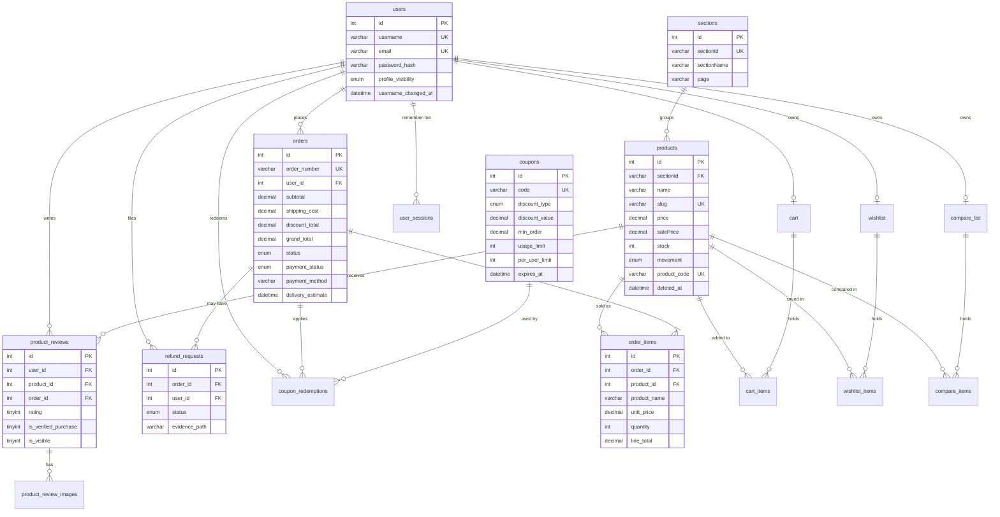
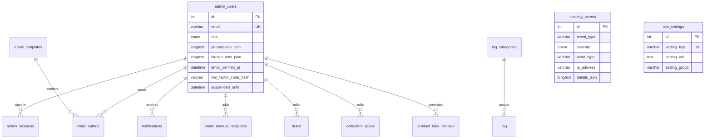

# Commerza Database

- **Engine:** MySQL 8 / MariaDB 10.4+ (InnoDB, `utf8mb4`)
- **Schema file:** [`database/commerza.sql`](../database/commerza.sql), 43 tables and 11 reporting views
- **Seed data:** 5 catalog sections, 40 products, FAQ, slider, ticker, testimonials, email templates, page meta, site settings, username blacklist
- **Not seeded:** admin accounts (created from `COMMERZA_ADMIN_BOOTSTRAP_*` on first admin request), customers, orders, sessions, rate-limit rows

Some columns and indexes are also self-healed at runtime (`ensure_*_schema` helpers), so an older database is upgraded the first time the relevant page or API runs.

## Entity relationship diagram (core commerce)



## Entity relationship diagram (administration and content)



## Table groups

| Group | Tables |
| --- | --- |
| Customers | `users`, `user_sessions`, `username_blacklist`, `customer_blacklist` |
| Catalog | `sections`, `products`, `product_trash`, `live_product_viewers` |
| Shopping | `cart`, `cart_items`, `wishlist`, `wishlist_items`, `compare_list`, `compare_items` |
| Orders | `orders`, `order_items`, `refund_requests`, `coupons`, `coupon_redemptions` |
| Reviews | `product_reviews`, `product_review_images`, `product_fake_reviews` |
| Admin | `admin_users`, `admin_sessions`, `notifications`, `security_events`, `rate_limits` |
| Email | `email_templates`, `email_outbox`, `email_manual_recipients`, `email_suppressed`, `engagement_reminders`, `newsletter_subscribers`, `contact_messages` |
| Content | `site_settings`, `page_meta`, `page_content`, `slider`, `ticker`, `social_links`, `collectors_speak`, `faq`, `faq_categories` |
| Reporting views | `vw_admin_dashboard_metrics`, `vw_order_summary`, `vw_order_details`, `vw_customer_stats`, `vw_low_stock_products`, `vw_products`, `vw_cart_details`, `vw_wishlist_products`, `vw_compare_products`, `vw_email_outbox_full`, `vw_faq_full` |

## Import

```bash
mysql -u root -e "CREATE DATABASE commerza CHARACTER SET utf8mb4 COLLATE utf8mb4_unicode_ci"
mysql -u root commerza < database/commerza.sql
```

Backup and restore verification lives in [`scripts/maintenance/BACKUP_RESTORE_TESTS.md`](../scripts/maintenance/BACKUP_RESTORE_TESTS.md).
